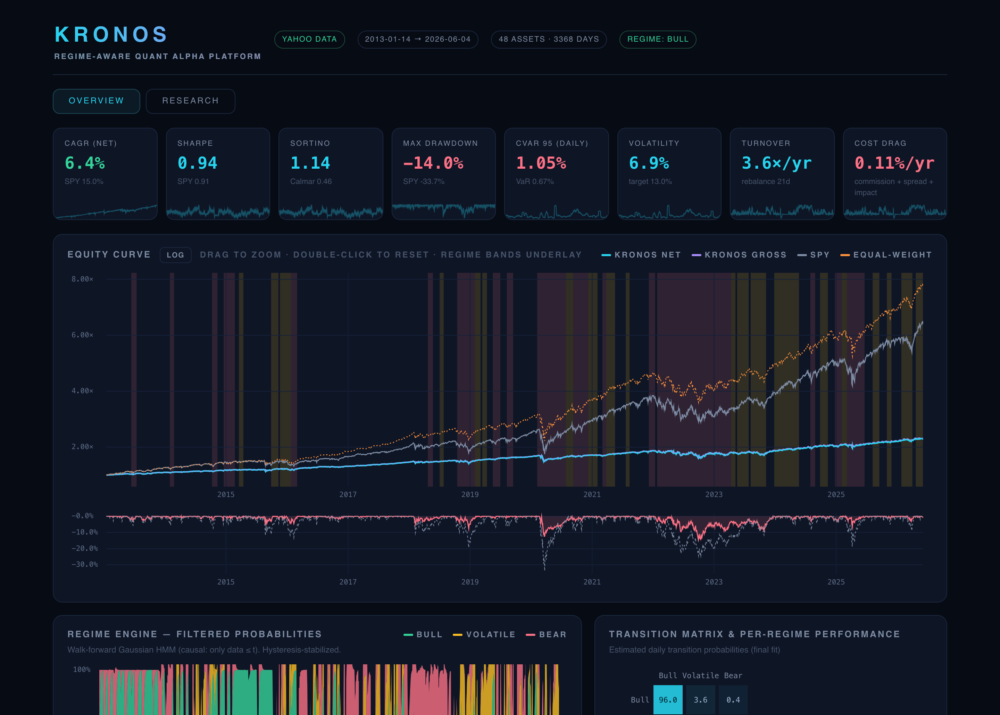
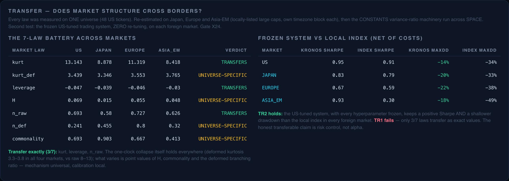
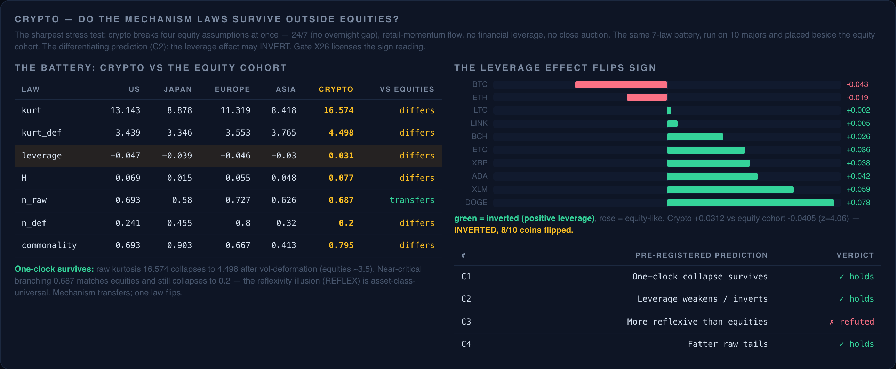

<h1 align="center">KRONOS</h1>

<p align="center">
  <b>A quantitative trading platform — and a market-microstructure research lab — built from first principles.</b><br>
  <sub>Every model hand-implemented on numpy / pandas / scipy. Every estimator validated against synthetic ground truth before it touches a real price.</sub>
</p>

<p align="center">
  <a href="https://github.com/Olivesz/kronos-quant/actions/workflows/ci.yml"></a>
  
  
  
  
  
</p>

<p align="center">
  
</p>

---

KRONOS is two things at once:

1. **A production-shaped quant platform** — data → equal-weight backbone →
   forecast-volatility risk overlay → a self-contained interactive dashboard.
   It runs end-to-end in ~25s and posts a **net Sharpe of 1.12 at −18.7% max
   drawdown** (0.97 in excess of cash): about equal-weight's Sharpe on
   the same names (1.10; 0.98 in excess of cash) at 64% of its
   drawdown, and a higher Sharpe than the S&P at 56% of its
   drawdown — sized by a forecast of its own volatility and tilted by the
   measured monthly-momentum information budget. The regime-gated
   HRP + Black-Litterman construction it replaced lost to 1/N under a
   pre-registered test, and the README says so below.

2. **A research program that treats markets like physics.** 37
   experiments ask what quant finance genuinely does not know — *is volatility
   rough? how many bits/day does the past leak about the future? are crashes
   critical transitions or shocks? is the market's near-criticality real?* —
   and answer them with confound-killing methodology, reporting the negative
   results as loudly as the positive ones.

What ties them together is one discipline: **no estimator is trusted until it
passes a gate on data where the answer is already known.** 50 such gates run in
CI on every commit — on the committed real prices with nothing skipped, and again
on a synthetic market. That is the whole point — the platform grades its own
homework.

> **Zero heavyweight dependencies.** No scikit-learn, no statsmodels, no
> PyTorch, no cvxpy. Baum-Welch EM, Student-t HMMs (own ECM), Kalman filters,
> GJR-GARCH MLE, HAR-RV, fractional-Gaussian-noise simulation, Marchenko-Pastur
> denoising, Rockafellar-Uryasev CVaR LPs, Hedge learners, deflated Sharpe /
> CSCV, Hierarchical Risk Parity, Black-Litterman, Hawkes-process MLE, and the
> canvas charting engine of the dashboard — all hand-built and gate-verified.

## Contents

- [Quick start](#quick-start)
- [Highlights](#highlights)
- [The platform](#the-platform)
- [The research program](#the-research-program)
- [Cross-market transfer](#cross-market-transfer)
- [Architecture](#architecture)
- [Research integrity](#research-integrity)
- [Reproducibility & data](#reproducibility--data)

## Quick start

```bash
python3 -m venv .venv && source .venv/bin/activate
pip install -r requirements.lock   # exact versions CI uses (or: pip install -e ".[data]")

python run_kronos.py              # full pipeline -> output/dashboard.html  (~25s)
python run_research.py all        # 37 research experiments, cached to research/*.json
python run_kronos.py --research   # dashboard with the RESEARCH tab (open output/dashboard.html)
python run_trade.py               # today's research-grounded target portfolio

python tests/run_all.py           # all 50 verification gates (~5 min)
```

Runs fully offline on real prices: every real-data result reads the
committed snapshot `live/genesis/*.csv.gz` (daily OHLC 2010–2026, checked
against its digest on every load), so no network is needed and the numbers
reproduce exactly. `KRONOS_DATA=yahoo` refreshes from Yahoo instead (adjusted
prices drift with each dividend re-adjustment); `KRONOS_SYNTHETIC=1` runs
everything on a seeded synthetic market. A failed real-data load raises — it
never silently substitutes synthetic data.

## Highlights

- **50 verification gates**, run in CI on real prices and on a synthetic
  market. Most prove an estimator has correct *size* (doesn't fire on null
  worlds) and *power* (detects planted effects) on synthetic ground truth
  before any real-data claim is made. On the committed real-price snapshot
  the suite also checks the battery's calibration (SPY scores 10/10, X19),
  the regime engine on the 2020 crash and the calm of 2017, range-based
  volatility against close-to-close on SPY (X1), backtest accounting, the
  snapshot's integrity (X39), and the headline itself (X40: the shipped book
  is recomputed and must match `research/momtilt.json`). In the real-data
  job a skipped assertion fails the build.
- **Strictly causal throughout** — filtered (not smoothed) HMM probabilities,
  frozen betas, walk-forward refits, T+1 execution, full transaction costs
  (commission + spread + square-root impact).
- **A rough-volatility replication** (H ≈ 0.10) and an **information-budget
  measurement** (the daily direction channel is *closed*; the Sharpe ceiling
  from sign-prediction alone is 0.48 < beta) — both on the project's own 16
  years of data.
- **A debunking with teeth**: after removing the volatility confound, critical-
  slowing-down early-warning signals carry *no* incremental crash-prediction
  information — the pre-crash signature is ~8× weaker than a real fold
  bifurcation. Crashes are shocks, not tipping points.
- **A cross-market transfer study** on Japan / Europe / Asia-EM: the *mechanism*
  laws are universal, the frozen US-tuned system holds its risk edge abroad,
  but the exact law *values* are local — stated as a clean split verdict.
- **A self-audit that found its own sign bug**: diagnosing "where does the
  return go?" exposed an inverted drawdown throttle that 30 green gates had
  missed (braking at equity highs, releasing into crashes). Fixed under
  pre-registered kill criteria, shipped *with* the missing gate, old numbers
  kept as the baseline row.
- A **1,700-line single-file HTML dashboard** with a hand-written canvas
  charting engine, zero external assets.

## The platform

The end-to-end book, `run_kronos.py`:

```
shipped:  prices ─▶ equal-weight 1/N backbone ─▶ risk overlay ─────────────────▶ dashboard
                                                 (HAR vol lever ≤1.5×, CVaR/DD brakes, 21d tilt)

control:  prices ─▶ HMM regimes ─▶ regime-gated signals ─▶ HRP + Black-Litterman ─▶ (same overlay)
                    (Bull/Vol/Bear)  (momentum/rev/low-vol)  (lost to 1/N — DESIGN27)
```

- **Construction (shipped)** — equal-weight 1/N over the names live at each
  monthly rebalance, with the same no-trade band, cost model (commission +
  spread + square-root impact) and drift accounting as every other variant.
- **Construction (research control, `backbone="hrp_bl"`)** — a **Student-t HMM**
  regime engine (filtered probabilities, walk-forward) gating 12-1 momentum,
  reversal and low-vol signals into a Hierarchical-Risk-Parity backbone tilted
  via Black-Litterman. It lost to 1/N under a pre-registered test
  ([KRONOS-EWBAR](docs/FINDINGS.md#kronos-ewbar--can-any-licensed-configuration-beat-1n))
  and is kept, not deleted, as the control every new construction must beat.
- **Risk** — vol targeting as the *lever* (up to 1.5×, financing charged on the
  levered portion) with the CVaR cap and drawdown throttle as *brakes* — the
  overlay's direction and reach are pinned by their own gate (X27; see
  [KRONOS-EDGE](docs/FINDINGS.md#kronos-edge--fixing-the-engines-structural-drag)).

| Strategy (2013-01-14 → 2026-06-04, net of costs) | CAGR | Vol | Sharpe (rf=0) | Sharpe (excess cash) | Max DD | CVaR95 |
|---|---|---|---|---|---|---|
| **KRONOS (shipped: 1/N + overlay + tilt)** | +13.6% | 12.0% | **1.12** | **0.97** | **−18.7%** | 1.86% |
| KRONOS (1/N + overlay, no tilt) | +13.2% | 11.8% | 1.11 | 0.96 | −18.0% | 1.82% |
| KRONOS (prior default: regime-gated HRP + BL) | +11.8% | 11.0% | 1.07 | 0.90 | −17.8% | 1.65% |
| Equal-weight (same 48 names, no overlay) | +16.6% | 15.0% | 1.10 | 0.98 | −29.5% | 2.22% |
| SPY (buy & hold) | +15.0% | 16.8% | 0.91 | 0.81 | −33.7% | 2.55% |

The overlay is risk control, not alpha: it holds equal-weight's Sharpe while
cutting its drawdown by a third, and nothing in the licensed toolkit beats 1/N
on excess-cash Sharpe (DESIGN27, reported as a failure). A sealed, survivorship-free
test on French's market from 1926 agrees: the shipped overlay lifts the market's
Sharpe (0.53 vs 0.39) but its alpha net of FF5, momentum and BAB is −1.19%
(t −1.18, 1963–2012), so no alpha survives ([VOLALPHA](docs/FINDINGS.md#kronos-volalpha--the-shipped-overlay-on-a-century-of-survivorship-free-factors)). Leverage financing
costs 0.77%/yr; selection risk is DSR 0.82 over N=202 logged trials; PBO 0.45
over 140 variants. The 48-name universe is today's large caps (hindsight), so
these are in-sample figures — every row comes from one run,
[`research/momtilt.json`](research/momtilt.json), which also commits the daily
NAV series.

**Live since 2026-08-17.** A daily CI job records the unlevered KRONOS-TRADE
system's target weights before each session in an append-only ledger
([`live/ledger.jsonl`](live/ledger.jsonl), every row reproducible from the
committed bars) and rebuilds its realized returns
([`live/performance.json`](live/performance.json)). As of 2026-10-12, 35
trading days: KRONOS-TRADE −2.38%, SPY +0.70%, equal-weight −2.25%; max
drawdown −4.98%, −2.47%, −4.77%. At this sample size a 35-day return has a
standard error of about ±2.75% for KRONOS-TRADE, and its −3.08% gap to SPY has
one of about ±3.11%: the gap is about one standard error, so the forward record
can neither confirm nor refute the backtest yet. The pre-registered horizon for
any verdict is three years ([DESIGN23](docs/design/DESIGN23.md)). This record
measures the unlevered KRONOS-TRADE book, not the shipped backtest above; a
second stream ([`live/shipped_ledger.jsonl`](live)) records the shipped book's
own next-day decisions from 2026-10-14, and replaying them reproduces the backtest
exactly (gate X43). The first stream's decisions
before 2026-10-13 were made on a panel with a 74-day hole, since repaired as a
logged event ([FINDINGS](docs/FINDINGS.md#kronos-live--the-forward-ledger-now-with-realized-returns)). A third
stream is built and waiting on the owner's broker paper-account keys: it trades the
shipped overlay on SPY each day (`run_paper.py`, `.github/workflows/paper.yml`), so
every order and fill carries the broker's own timestamp; gate X48 pins its decision
to the shipped overlay and its client to the paper host.

## The research program

37 experiments, pre-registered in [`docs/design/`](docs/design) and gated
before real data. The one-line answers — **full write-ups, tables, and methods
in [`docs/FINDINGS.md`](docs/FINDINGS.md)**:

| Study | The question | The finding |
|---|---|---|
| [X²](docs/FINDINGS.md#regimes-or-fat-tails) | 3 regimes or 5? | **Gaussian HMMs hallucinate regimes from fat tails** — a Student-t HMM stays flat at K=3. It's ~3 regimes + heavy tails. |
| [LAWS](docs/FINDINGS.md#kronos-laws--invariance-hunting) | Is there a universal return law? | **The One-Clock law**: returns are conditionally Gaussian given the realized-vol path (kurtosis 12.6 → 2.6 across 48 assets, one shared distribution). |
| [CLOCK](docs/FINDINGS.md#kronos-clock--is-systemic-risk-just-correlated-clocks) | Is systemic risk contagion? | No — it's **correlated volatility clocks**. Joint crashes are common vol surges, ~Gaussian copula once you condition on the clock. |
| [SURGE](docs/FINDINGS.md#kronos-surge--the-structure-of-the-surges) | Does the cascade recurse? | No — it **terminates after one level**. Volatility has irreducible jumps; the one-clock law does not iterate. |
| [BITS](docs/FINDINGS.md#kronos-bits--the-information-budget-of-the-market) | How predictable is the market? | The **direction channel is closed** (~0 bits/day, ceiling Sharpe 0.48 < beta); the **magnitude channel leaks ~0.4 bits/day**. |
| [ARROW](docs/FINDINGS.md#kronos-arrow--entropy-production) | Where does time's arrow live? | In the **return↔clock coupling**, not in returns themselves — vol-deformation erases the entropy production. |
| [CRITICAL](docs/FINDINGS.md#kronos-critical--are-crashes-critical-transitions-or-shocks) | Critical transitions or shocks? | **Shocks.** After the vol confound is removed, critical-slowing-down carries no incremental crash signal (~8× weaker than a real bifurcation). |
| [REFLEX](docs/FINDINGS.md#kronos-reflex--how-endogenous-is-the-market) | Is the market self-exciting? | Mostly an **illusion**: 64% of the famous near-criticality (branching 0.68 → 0.25) is volatility clustering, not reflexivity. |
| [CONSTANTS](docs/FINDINGS.md#kronos-constants--which-market-laws-are-actually-constant) | Do the laws drift over time? | **Mechanism constants are constant**; only crisis *intensity* moves (peaks 2020, reverts). No Adaptive-Markets secular drift. |
| [DECATHLON](docs/FINDINGS.md#kronos-decathlon--the-minimal-market) | Smallest market that looks real? | A **vol-targeting spiral** buys the wild facts; the ceiling is 5/10 and the missing organ is **expectation** (anticipatory agents). |
| [DECATHLON-2](docs/FINDINGS.md#kronos-decathlon-2--is-expectation-the-missing-organ) | Is expectation the missing organ? | **Refuted.** A causal, gate-verified anticipator front-running the vol-targeter flow leaves the ceiling at 5/10 — one layer of expectation moves the sign leak a derivative earlier instead of removing it; information-free prices need the *fixed point* of anticipation. |
| [TRADE](docs/FINDINGS.md#kronos-trade--the-deployable-system) | What system does the science license? | Forecast-vol targeting + regime-gated risk parity + mechanical crash control — risk control, never direction timing. (The live forward ledger tracks this unlevered system.) |
| [TRANSFER](docs/FINDINGS.md#kronos-transfer--does-market-structure-cross-borders) | Do the laws cross borders? | **Mechanism universal, calibration local** — see below. |
| [CRYPTO](docs/FINDINGS.md#kronos-crypto--do-the-laws-survive-outside-equities) | Do the laws survive outside equities? | Mostly yes — but the **leverage effect inverts** (crypto +0.03 vs equities −0.04; 8/10 coins flip). Mechanism universal; one law is equity-specific. |
| [FX](docs/FINDINGS.md#kronos-fx--the-third-vertex-of-the-microstructure-triangle) | Where does FX sit on the leverage triangle? | **Statistically zero** (+0.005, z vs equities 3.89) — the triangle equity −0.04 / FX ≈ 0 / crypto +0.03 is monotone in microstructure; yen crosses carry the safe-haven tilt. |
| [EDGE](docs/FINDINGS.md#kronos-edge--fixing-the-engines-structural-drag) | Why is CAGR half the risk budget? | Diagnosis found an **inverted drawdown throttle** (braking at peaks, releasing into crashes) and an unreachable vol target. Fixed + gated: Sharpe 0.94 → 1.02 unlevered; CAGR 6.4% → 10.9% levered. |
| [EDGE2](docs/FINDINGS.md#kronos-edge2--the-research-licensed-performance-program) | What had the research already licensed? | The **HAR forecast lever** (X28) and the **t-HMM engine** (X29), each surviving its kill criterion, stacking to **Sharpe 1.05 @ −18.8% MaxDD**. |
| [EWBAR](docs/FINDINGS.md#kronos-ewbar--can-any-licensed-configuration-beat-1n) | Can any licensed configuration beat 1/N? | **No — stated as a FAILURE** under the pre-registered rule. Best candidate (EW backbone + shipped overlay) beats equal-weight's raw Sharpe (**1.12** vs 1.10) at **64% of its drawdown**, but excess-over-cash lands 0.010 short: leverage financing cannot clear a cash-adjusted bar. The backbone, not the overlay, is what 1/N beats. |
| [VOLALPHA](docs/FINDINGS.md#kronos-volalpha--the-shipped-overlay-on-a-century-of-survivorship-free-factors) | Does the shipped overlay earn alpha on a survivorship-free century? | **On the market, no** — Moreira & Muir and Cederburg et al. replicate first, then the sealed 1926–2012 holdout gives a Sharpe gain (0.53 vs 0.39) but a full-model α of −1.19% (t −1.18) net of FF5, UMD and BAB. On factor portfolios the same real-time overlay earns gross alphas that survive Romano-Wolf (UMD, BAB, RMW, HML, CMA) — before their trading costs, which factor data cannot price. |

## Cross-market transfer

Every law above was measured on one universe (48 US tickers). KRONOS-TRANSFER
re-runs the entire law battery — and the *frozen*, US-tuned trading system,
with zero re-tuning — on **Japan, Europe, and Asia-EM**.

<p align="center">
  
</p>

(The panel above shows the previous system; the figures below are the shipped
book.) The law battery gives a clean split verdict: the mechanism laws (fat
tails, leverage effect, near-critical branching, the one-clock collapse)
reappear in every market, but the exact law *values* (H, clock commonality,
deformed branching) are market-specific — **universality of mechanism,
locality of calibration.**

The shipped book, frozen with every US setting and rerun on the committed
foreign panels ([`research/transfer.json`](research/transfer.json); the US
leg reproduces the headline exactly):

| Market | KRONOS Sharpe | Equal-weight Sharpe | Index Sharpe | KRONOS MaxDD | Equal-weight MaxDD | Index MaxDD |
|---|---|---|---|---|---|---|
| Japan | 0.78 | 0.95 | 0.79 | −15.6% | −29.4% | −32.7% |
| Europe | 0.47 | 0.71 | 0.59 | −17.4% | −37.4% | −38.5% |
| Asia-EM | 0.78 | 0.96 | 0.30 | −22.1% | −29.0% | −49.4% |

Out of sample, the book keeps a positive Sharpe and roughly half the local
index's drawdown everywhere, but equal-weight on the same names beats its
Sharpe in all three markets, and in Japan and Europe the index does too. The transferable
claim is risk control, not alpha. An earlier run of this study, on the
unlevered system before the drawdown-throttle fix
([`research/transfer.json` at 2a732c1](https://github.com/Olivesz/kronos-quant/blob/2a732c1/research/transfer.json)),
scored 0.83 / 0.67 / 0.93 abroad, so the changes since did not travel. One
untested explanation: leverage up to 1.5× financed at a US 3.5% rate drags in
lower-return markets. Sharpe here is
rf=0 (local cash rates are not in the repo); equal-weight is daily 1/N before
costs.

### Frontier: does the leverage law survive crypto?

If the laws are properties of *markets*, they should survive a market that
shares none of equities' plumbing. KRONOS-CRYPTO runs the same 7-law battery on
10 crypto majors — 24/7, no overnight gap, retail-driven, no financial leverage
— alongside the equity cohort.

<p align="center">
  
</p>

The mechanism is portable — the one-clock collapse (kurtosis 16.6 → 4.5),
near-critical branching and its vol-clustering illusion, roughness, and fat
tails all reappear. But the **leverage effect cleanly inverts**: crypto reads
**+0.03** versus the equity cohort's **−0.04** (z = 4.06), and **8 of 10 coins
individually flip positive** — only BTC and ETH keep the equity sign. The
leverage effect is not a market universal; it is a property of the *equity*
microstructure, and it reverses where that microstructure is absent. (Gate X26
licenses the sign reading.)

## Architecture

```
config.py                 every knob; pre-registered parameters
run_kronos.py             v1 pipeline -> dashboard (+ --research tab)
run_research.py           37 experiments, cached in research/*.json
run_trade.py              the deployable system -> today's target portfolio
kronos/                   48 modules, ~10,400 lines
  data.py                 prices + OHLC, caching, seeded synthetic fallback
  regime.py / dhmm.py     Gaussian HMM (log-space EM, walk-forward) + duration-HMM
  thmm.py / sjm.py        Student-t HMM (own ECM) + statistical jump model
  signals.py / backtest.py  momentum/reversal/low-vol, regime-gated; T+1 engine
  pairs.py / statarb.py   Kalman pairs + Avellaneda-Lee eigenportfolio stat-arb
  covariance.py / hrp.py  Ledoit-Wolf + EWMA shrinkage; Hierarchical Risk Parity
  black_litterman.py      BL tilt with signal views
  cvar_opt.py / risk.py   min-CVaR LP (Rockafellar-Uryasev); vol/CVaR/DD throttles
  volest.py / vollab.py   Garman-Klass range vol; HAR-RV, GJR-GARCH-t, Diebold-Mariano
  rough.py / rfsv.py      Hurst estimator + fGn simulation; rough-vol forecaster
  laws.py / clock.py      one-clock deformation; correlated-clock tail tests
  surge.py / infobudget.py  cascade structure; KSG/binned mutual information
  entropyprod.py          path-space entropy production (arrow of time)
  critical.py / hawkes.py   critical-slowing-down; Hawkes branching ratio
  constants.py            cross-era law-stability tests
  decathlon.py            agent-based minimal market + the stylized-fact battery
  transfer.py             cross-market law battery + frozen-system backtest
  crypto.py               crypto universe + cross-asset-class leverage contrast
  rmt.py / ensemble.py    Marchenko-Pastur denoising; Hedge/fixed-share learners
  forensics.py            deflated Sharpe, CSCV-PBO, stationary bootstrap
  metrics.py / dashboard.py  performance stats; 1,700-line self-contained HTML
tests/                    50 gates — run on real prices and on a synthetic market
docs/                     METHODS, ATLAS, design notes, FINDINGS, research index
```

## Research integrity

The discipline that makes the results worth reading — and a blog-style deep-dive
into all of it in **[docs/METHODS.md](docs/METHODS.md)** (*"How do you know
you're not fooling yourself?"* — the gate philosophy, look-ahead control, the
volatility clock, bootstraps, out-of-sample model comparison, overfitting
forensics, and information-theoretic ceilings):

- **No look-ahead anywhere** — filtered probabilities, frozen betas, T+1
  execution, walk-forward refits. Look-ahead-sensitive code carries a causality
  gate (`test_trade.py`: shifting all inputs forward one day must not change a
  single historical weight).
- **Gate before you claim** — every estimator is proven on synthetic worlds
  with known truth, demonstrating both size (no false positives on null worlds)
  and power (detects planted effects), *before* any real-data result.
- **Costs everywhere** — 1bp commission + 2bp spread + square-root impact
  (capped), on every trade.
- **Negative results reported as prominently as positive ones** — stat-arb is
  dead, RMT doesn't help here, durations don't beat the plain HMM, the trading
  system doesn't beat the S&P on CAGR. All stated plainly.
- **The strategy audits itself** — a deflated Sharpe (fed by a trial ledger) and
  a CSCV probability-of-backtest-overfitting run on KRONOS's own configuration
  family: the test most backtests never run.

See the [Atlas of Ignorance](docs/ATLAS.md) for the open-problem map that scopes
the whole program, and [`CONTRIBUTING.md`](CONTRIBUTING.md) for the one rule.

## Reproducibility & data

Data: 48 US large caps and ETFs, daily Yahoo-adjusted OHLC 2010–2026,
committed as [`live/genesis/`](live/genesis) and verified against
`META.json` on every load. Every random path is seeded; every gate is
deterministic. The synthetic market (CI's hermetic job) is a seeded
regime-switching factor model with Student-t innovations.

**The universe was picked with hindsight.** The 36 single stocks are 2026's
large caps (NVDA, NFLX, CRM and the rest), chosen when the project started, not
by any rule that could have been applied in 2010. Names that faded or were
delisted are absent, which flatters every long-only result above, the
equal-weight benchmark included. It has not been re-picked to hide this.

> **Not investment advice.** This is a research and engineering portfolio, not
> a trading recommendation.

## License

[MIT](LICENSE)
